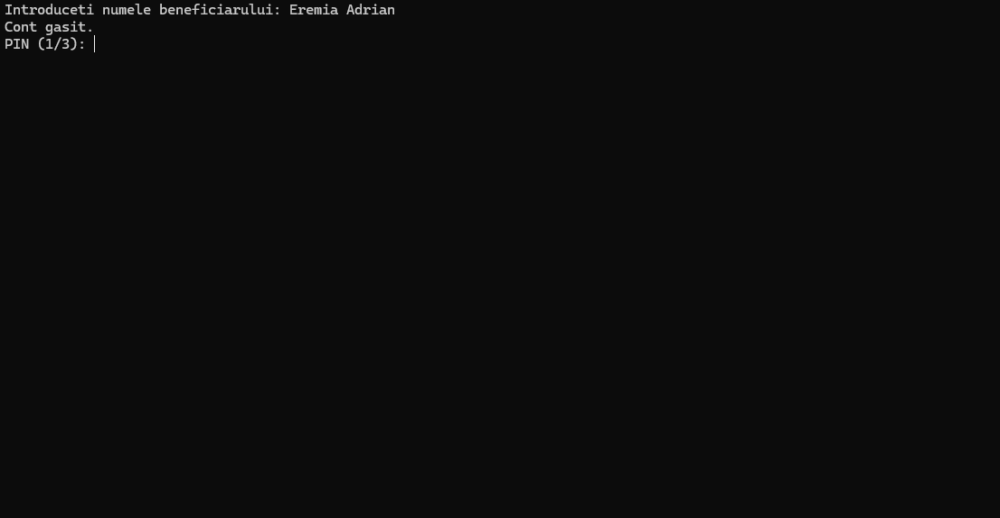
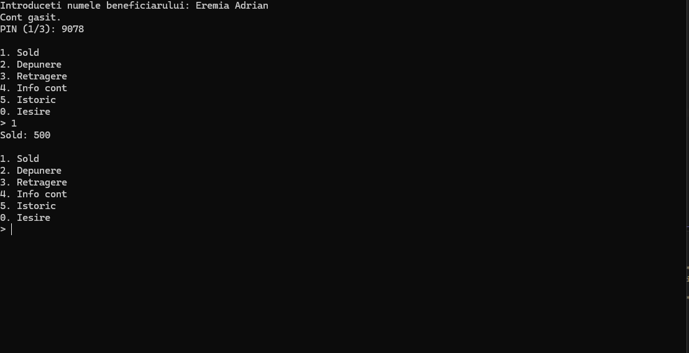
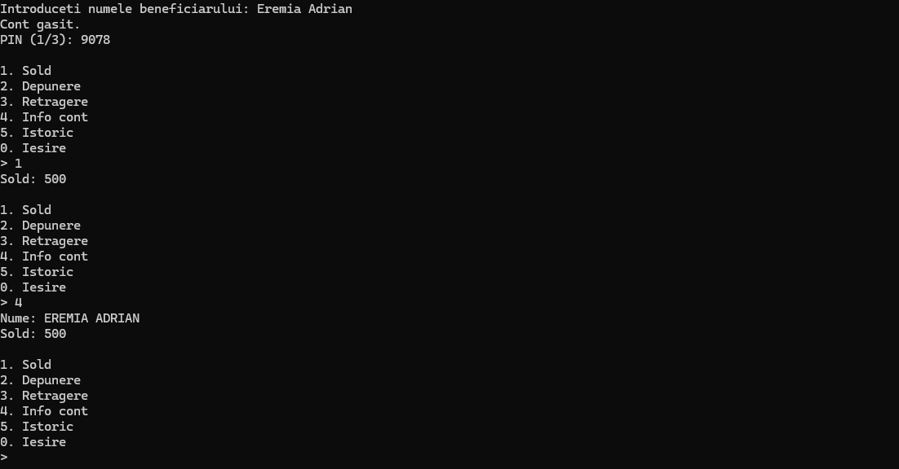
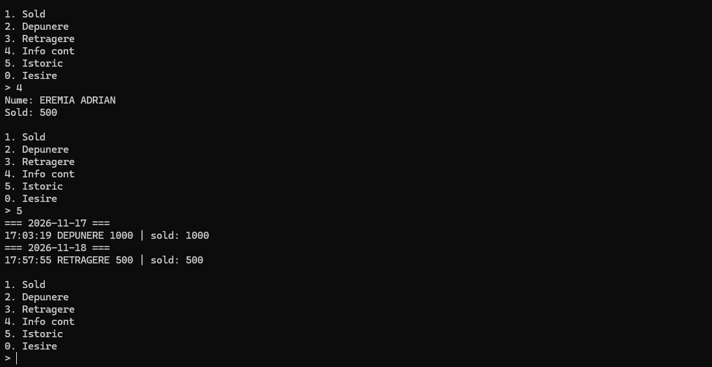
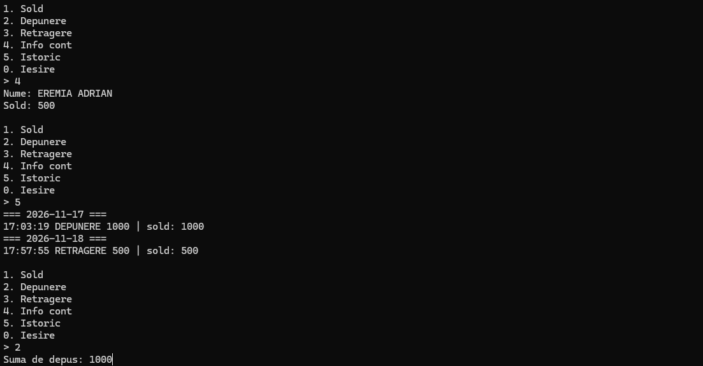

# PseudoATM

Simulator de ATM în C++, realizat ca proiect pentru cursul PCLP1.

## Funcționalități

- Creare cont nou cu nume și PIN de 4 cifre
- Autentificare cu maximum 3 încercări
- Consultare sold, depunere și retragere de bani
- Istoric al tranzacțiilor cu data și ora, grupat pe zile
- Salvarea și încărcarea conturilor din fișiere text

## Demonstrație

### 1. Autentificare
Dacă există un cont cu numele introdus, programul cere PIN-ul (maximum 3 încercări).



### 2. Meniul principal și soldul
După autentificare apare meniul cu toate opțiunile.



### 3. Informații cont
Afișează numele titularului și soldul curent.



### 4. Istoric tranzacții
Tranzacțiile sunt grupate pe zile, fiecare cu ora, tipul, suma și soldul rezultat.



### 5. Depunere
Suma se introduce de la tastatură, iar tranzacția se salvează automat în istoric.



## Structura proiectului

| Fișier | Rol |
|---|---|
| `account.h` | Declarația clasei `Account` |
| `account.cpp` | Implementarea clasei (PIN, tranzacții, fișiere, istoric) |
| `main.cpp` | Meniul principal și fluxul programului |

## Cum se rulează

**Visual Studio:** deschide `PseudoATM.slnx` și apasă pe **Local Windows Debugger**.

**Din terminal (g++):**

```
g++ -std=c++17 PseudoATM/main.cpp PseudoATM/account.cpp -o atm
./atm
```

## Cum funcționează

La pornire se introduce numele beneficiarului:

- dacă există deja un cont cu acel nume, se cere PIN-ul;
- dacă nu există, se creează un cont nou și se alege un PIN.

Conturile se salvează în fișiere `cont_NUME.txt`, iar istoricul în `cont_NUME_istoric.txt`, în folderul din care rulează programul. Aceste fișiere sunt excluse din repository prin `.gitignore`.

## Notă

PIN-ul este salvat ca hash (FNV-1a), nu în clar. Hash-ul nu este sigur criptografic (un PIN de 4 cifre are doar 10000 de variante), deci proiectul are scop strict educativ.